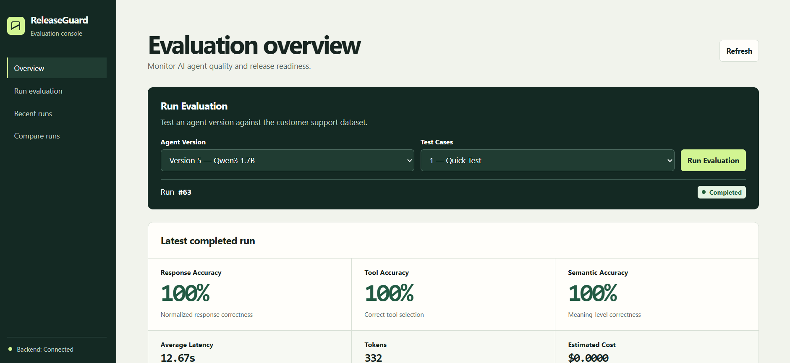
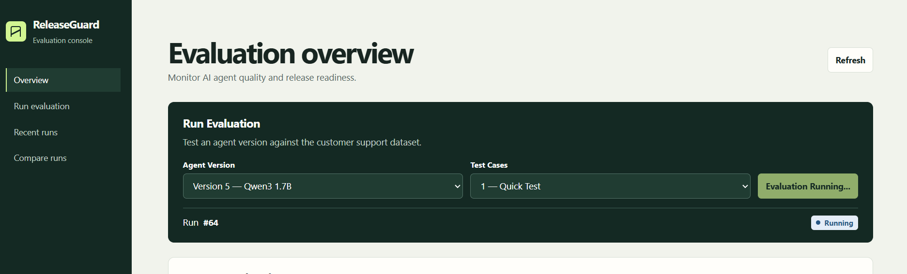
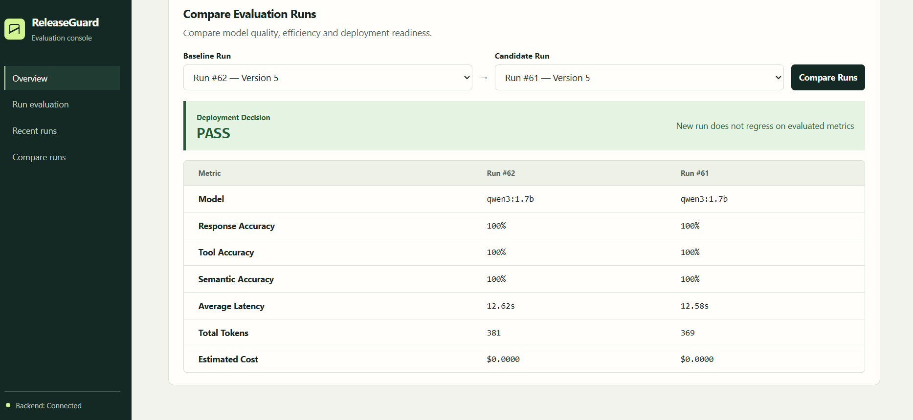
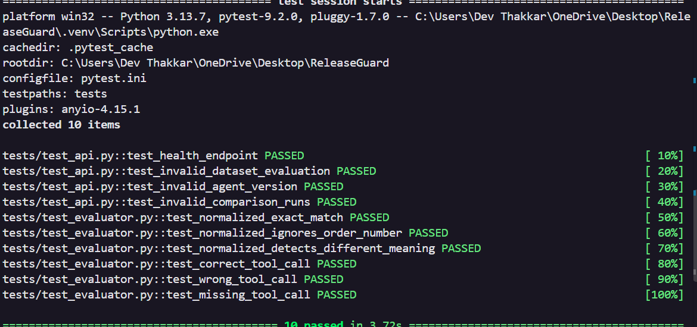
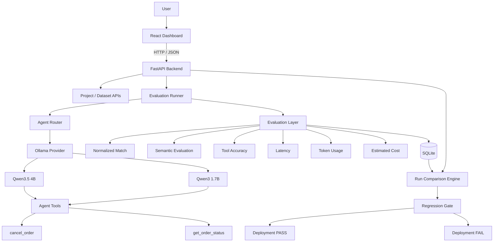

# ReleaseGuard

**AI Agent Evaluation and Release Safety Platform**

ReleaseGuard is a full-stack evaluation platform for testing AI agents before deployment. It runs agent versions against structured datasets, measures response quality, tool usage, semantic correctness, latency, token usage, and estimated cost, then compares evaluation runs to determine whether a new version is safe to release.

The project is designed around a simple question:

> **Did this new AI agent version actually improve without breaking existing behavior?**

---

## Overview

AI agents can change behavior when prompts, models, tools, or application logic change. Traditional software tests are not always enough because two responses can have different wording while still meaning the same thing, and an agent can sometimes return the correct answer while using the wrong tool internally.

ReleaseGuard evaluates multiple dimensions of agent behavior and stores the results for comparison.

A typical evaluation flow is:

```text
Project
   ↓
Dataset
   ↓
Test Cases
   ↓
Agent Version
   ↓
Evaluation Run
   ↓
Agent Response + Tool Calls
   ↓
Evaluation Metrics
   ↓
Run Comparison
   ↓
Deployment PASS / FAIL
```

---

## Key Features

- Run structured evaluation datasets against multiple AI agent versions
- Evaluate normalized response correctness
- Evaluate semantic equivalence using a local LLM judge
- Validate tool selection and record tool-call traces
- Compare model versions across evaluation runs
- Detect regressions before deployment
- Generate a deployment `PASS` or `FAIL` decision
- Track response latency
- Track prompt, output, and total token usage
- Estimate model cost
- Support smoke tests and full evaluation runs
- Detect dataset changes using SHA-256 fingerprints
- Run evaluations in the background without blocking API requests
- Monitor evaluation status from the React dashboard
- Compare different local models through Ollama
- Run the backend inside Docker
- Persist SQLite data using Docker volumes
- Run automated unit and API tests with pytest

---

## Dashboard

The React dashboard provides a UI for running and monitoring evaluations without using Swagger directly.

The dashboard includes:

- evaluation quality metrics
- recent evaluation runs
- evaluation launcher
- background-run status tracking
- model comparison
- deployment decisions
- latency, token, and cost information

Add a screenshot here after completing the final demo:

```text
docs/images/dashboard.png
```

Example:

```markdown
## Screenshots

### Dashboard



### Running an Evaluation



### Model Comparison and Deployment Gate



### Automated Tests


```

---

## Architecture



---

## Evaluation Pipeline

Each test case contains:

```text
input
expected response
expected tool
```

ReleaseGuard sends the input to the selected agent version and records:

```text
actual response
tool calls
tool arguments
tool results
latency
token usage
estimated cost
```

The result is then evaluated using several metrics.

### Response Accuracy

ReleaseGuard first performs normalized comparison.

Normalization currently:

- converts text to lowercase
- trims whitespace
- normalizes repeated spaces
- removes order-number differences where appropriate

This provides a fast deterministic evaluation.

### Semantic Accuracy

If normalized matching fails, ReleaseGuard can use a local Qwen model as a semantic evaluator.

This allows responses such as:

```text
Expected:
The order is currently being delivered.

Actual:
Order #456 is currently in transit.
```

to be recognized as semantically equivalent even though the strings are different.

To avoid unnecessary LLM calls, semantic evaluation is only invoked when normalized matching fails.

### Tool Accuracy

ReleaseGuard validates whether the agent selected the expected tool.

For example:

```text
Input:
Cancel Order #789

Expected tool:
cancel_order
```

An agent that returns a correct-looking response but internally calls:

```text
get_order_status
```

can still be detected as a regression.

This separates **final-answer correctness** from **agent-behavior correctness**.

---

## Deployment Gate

ReleaseGuard compares a baseline run against a candidate run.

The current deployment gate checks for regressions in:

```text
Response Accuracy
Tool Accuracy
Semantic Accuracy
```

If the candidate does not regress on evaluated quality metrics:

```text
Deployment Decision: PASS
```

If one or more quality metrics regress:

```text
Deployment Decision: FAIL
```

Latency, token usage, and cost are displayed for engineering comparison but are currently informational rather than release-blocking metrics.

---

## Dataset Versioning

Evaluation comparisons should only be trusted when both runs use equivalent test data.

ReleaseGuard creates a SHA-256 fingerprint from the test cases used in each evaluation.

If the dataset changes between two runs, ReleaseGuard rejects the comparison instead of presenting misleading results.

This protects comparisons from situations such as:

```text
Run A → 3 test cases

Run B → modified or different test cases
```

---

## Smoke Tests vs Full Runs

ReleaseGuard supports two evaluation modes.

### Smoke Run

A smoke run executes only a limited number of test cases.

Example:

```json
{
  "dataset_id": 1,
  "agent_version_id": 5,
  "max_test_cases": 2
}
```

Smoke runs are useful during development because local LLM evaluation can be relatively slow.

### Full Run

A full run executes the complete dataset.

```json
{
  "dataset_id": 1,
  "agent_version_id": 5,
  "max_test_cases": null
}
```

ReleaseGuard prevents comparisons between incompatible run types.

---

## Background Evaluations

Evaluation requests are non-blocking.

Instead of making the HTTP request wait while the model completes every test, ReleaseGuard creates an evaluation run and immediately returns its ID.

```text
POST /evaluation-runs
        ↓
pending
        ↓
running
        ↓
completed
```

The frontend polls the backend for status changes and automatically refreshes when the run finishes.

The current version uses FastAPI background tasks. A production-scale implementation could later use a durable worker system such as Celery, RQ, Redis, or a managed job queue.

---

## Model Provider Architecture

Agent execution is routed through a provider abstraction rather than being directly tied to a specific model.

Current provider:

```text
Ollama
```

Current development models:

```text
qwen3.5:4b
qwen3:1.7b
```

The architecture allows additional providers such as OpenAI, Anthropic, or Gemini to be added later without rewriting the evaluation pipeline.

---

## Tech Stack

### Backend

```text
Python
FastAPI
SQLite
Pydantic
Ollama
pytest
```

### Frontend

```text
React
JavaScript
Vite
CSS
```

### Infrastructure

```text
Docker
Docker volumes
Environment variables
Git / GitHub
```

---

## Project Structure

```text
ReleaseGuard/
│
├── main.py
├── database.py
├── agent.py
├── agent_tools.py
├── provider_router.py
├── ollama_agent.py
├── evaluator.py
├── semantic_evaluator.py
├── evaluation_runner.py
│
├── releaseguard.db
├── requirements.txt
├── Dockerfile
├── .dockerignore
├── .env.example
├── pytest.ini
│
├── tests/
│   ├── conftest.py
│   ├── test_api.py
│   └── test_evaluator.py
│
└── frontend/
    ├── src/
    │   ├── App.jsx
    │   ├── App.css
    │   ├── main.jsx
    │   └── components/
    │       └── RunComparison.jsx
    │
    ├── package.json
    └── .env.example
```

---

## Running Locally

### Requirements

Install:

```text
Python 3.13+
Node.js
Ollama
Git
```

Clone the repository:

```bash
git clone https://github.com/Dev-1508/ReleaseGuard.git
cd ReleaseGuard
```

Create a Python virtual environment:

```bash
python -m venv .venv
```

On Windows:

```powershell
.venv\Scripts\Activate.ps1
```

Install backend dependencies:

```bash
pip install -r requirements.txt
```

Start Ollama:

```powershell
ollama serve
```

Ensure the required models are installed:

```powershell
ollama list
```

Start FastAPI:

```powershell
uvicorn main:app
```

The backend will run at:

```text
http://127.0.0.1:8000
```

Swagger documentation is available at:

```text
http://127.0.0.1:8000/docs
```

---

## Running the Frontend

Open another terminal:

```bash
cd frontend
npm install
npm run dev
```

The frontend normally runs at:

```text
http://localhost:5173
```

The frontend API URL can be configured using:

```text
VITE_API_URL
```

Example:

```text
VITE_API_URL=http://127.0.0.1:8000
```

---

## Running with Docker

Build the backend image:

```powershell
docker build -t releaseguard-backend .
```

If Docker Desktop has difficulty reading the Dockerfile from a OneDrive-backed directory, the Dockerfile can be passed through standard input:

```powershell
Get-Content -Raw .\Dockerfile | docker build -f - -t releaseguard-backend .
```

Run the backend:

```powershell
docker run --rm `
  --name releaseguard-backend `
  -p 8000:8000 `
  -e OLLAMA_HOST=http://host.docker.internal:11434 `
  -e DATABASE_PATH=/data/releaseguard.db `
  -v releaseguard-data:/data `
  releaseguard-backend
```

The Docker container runs FastAPI while communicating with Ollama running on the host machine.

The `releaseguard-data` Docker volume keeps the SQLite database persistent even when the container is removed.

---

## Environment Variables

Backend:

```text
OLLAMA_HOST=http://localhost:11434
DATABASE_PATH=releaseguard.db
```

Frontend:

```text
VITE_API_URL=http://127.0.0.1:8000
```

Example values are included in the `.env.example` files.

Real `.env` files should not be committed to Git.

---

## Automated Tests

ReleaseGuard includes automated tests for both evaluation logic and API behavior.

Run:

```bash
python -m pytest -v
```

The test suite covers areas including:

```text
normalized response evaluation
tool-call evaluation
health endpoint behavior
invalid dataset handling
invalid agent-version handling
invalid run comparisons
```

These tests verify ReleaseGuard itself independently from the datasets used to evaluate AI agents.

---

## Example Model Comparison

One development benchmark compared:

```text
Qwen3.5 4B
vs
Qwen3 1.7B
```

Both models achieved:

```text
Response Accuracy: 100%
Tool Accuracy: 100%
Semantic Accuracy: 100%
```

while the smaller model showed substantially lower response latency in a warmed local run.

This demonstrates one of ReleaseGuard's main use cases:

> Compare AI models not only on correctness, but also on operational characteristics while enforcing a quality regression gate.

Local performance results depend heavily on hardware, model warm-up state, and CPU/GPU configuration, so benchmark values should not be interpreted as universal model-performance claims.

---

## Current Limitations

ReleaseGuard v1 intentionally keeps several infrastructure components simple.

Current limitations include:

- SQLite rather than PostgreSQL
- FastAPI background tasks rather than a durable job queue
- local Ollama inference rather than a hosted production model service
- no authentication or multi-user access
- semantic evaluation currently uses a local Qwen judge
- small demonstration datasets
- limited provider integrations

These were deliberate scope decisions to keep the first version focused on the evaluation and regression-detection workflow.

---

## Future Improvements

Potential next steps include:

- PostgreSQL support
- Redis-backed job queues
- Celery or RQ workers
- hosted model providers
- multiple semantic judge models
- authentication and team workspaces
- dataset import/export
- richer trace visualization
- failure clustering
- evaluation history charts
- configurable deployment policies
- CI/CD integrations
- GitHub pull-request evaluation gates
- larger benchmark datasets
- cloud deployment

---

## Why I Built ReleaseGuard

AI applications introduce a testing problem that traditional software test suites do not completely solve.

A new model or prompt may:

- return differently worded but correct responses
- select the wrong tool while returning a plausible answer
- introduce regressions on previously working cases
- dramatically change latency or token usage
- behave differently after datasets or prompts change

ReleaseGuard explores how software-engineering practices such as automated testing, regression detection, versioning, observability, and deployment gates can be applied to AI agents.

---

## Status

ReleaseGuard is currently a portfolio-oriented v1 focused on demonstrating:

```text
AI evaluation
agent tooling
backend architecture
full-stack development
model comparison
software testing
containerization
release safety
```

The core evaluation workflow is functional end-to-end.